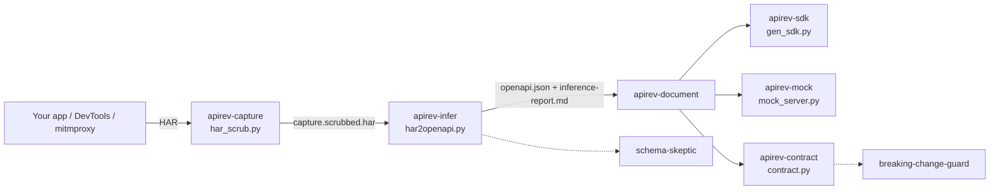

# api-reverse-skill

**Turn any undocumented API into an OpenAPI spec, a typed SDK, a mock server and contract tests,
from a HAR file you already have.**


You inherited a service with no docs. Or your frontend talks to a backend whose only spec is
"read the controller". Or QA needs a mock and the backend team is busy. The API exists, it
works, and every request it handles is already sitting in your browser's network tab. What is
missing is the paperwork.

This Claude Code pack turns recorded traffic into that paperwork. It scrubs the capture first
(tokens, cookies, keys, emails and phone numbers), infers an OpenAPI 3.0.3 spec from every
sample, and writes a report that says how many requests back each endpoint and which guesses
are shaky. From the spec it generates zero-dependency TypeScript and Python clients, serves a
local mock that replays real responses, and diffs specs for breaking changes in CI.

Everything runs locally with the Python standard library. The output is deterministic, so a
spec regenerated from the same capture produces a clean, empty diff.

## What's inside

| Skill | What it does |
|---|---|
| [`apirev-capture`](skills/apirev-capture/SKILL.md) | Guides a safe capture (DevTools HAR, mitmproxy on your own app, access logs) and writes a scrubbed copy with `har_scrub.py`. |
| [`apirev-infer`](skills/apirev-infer/SKILL.md) | `har2openapi.py`: path templates, query params, merged JSON schemas, auth, pagination, plus `inference-report.md`. |
| [`apirev-document`](skills/apirev-document/SKILL.md) | Adds operationIds, summaries, tags and descriptions, then writes `api/README.md` with curl examples. Marks guesses. |
| [`apirev-sdk`](skills/apirev-sdk/SKILL.md) | `gen_sdk.py`: typed TypeScript (fetch) and Python (urllib) clients, no dependencies. |
| [`apirev-mock`](skills/apirev-mock/SKILL.md) | `mock_server.py`: replays recorded responses by path template, with latency and seeded errors. |
| [`apirev-contract`](skills/apirev-contract/SKILL.md) | `contract.py validate` (traffic vs spec) and `diff` (spec vs spec), with `--fail-on breaking` for CI. |
| [`apirev-explore`](skills/apirev-explore/SKILL.md) | Answers "how do I do X" with the operation, a curl, an SDK call and the confidence behind it. |

| Agent | What it does |
|---|---|
| [`api-cartographer`](agents/api-cartographer.md) | Maps resources, relationships, flows (login -> list -> detail -> update) and capture gaps. |
| [`schema-skeptic`](agents/schema-skeptic.md) | Hunts over-fitting: thin required lists, fake enums, ids typed as numbers, missing errors. |
| [`breaking-change-guard`](agents/breaking-change-guard.md) | Turns a contract report into a verdict: safe, breaking, or needs a version bump. |

## Install

```
/plugin marketplace add vivekbhange-hub/api-reverse-skill
/plugin install api-reverse-skill@api-reverse-skill
```

Manual install: copy `skills/*` into `~/.claude/skills/` and `agents/*` into `~/.claude/agents/`.

Requirements: Python 3.9 or newer. Nothing else.

## Try it in 60 seconds

The repo ships a fictional capture, [`examples/petshelter.har`](examples/petshelter.har): 27
requests to a Pet Shelter API on the reserved `.example` domain, with a fake JWT, a fake API key,
fake emails, and noise (a logo, a stylesheet, an analytics beacon, an HTML page). In Claude Code:

> Reverse engineer the API in examples/petshelter.har

Or run the same steps yourself (on Windows use `python` instead of `python3`):

```
python3 skills/apirev-capture/har_scrub.py examples/petshelter.har -o api/capture.scrubbed.har \
  --include-host api.petshelter.example --pii
python3 skills/apirev-infer/har2openapi.py api/capture.scrubbed.har --out api --title "Pet Shelter API" --yaml
python3 skills/apirev-sdk/gen_sdk.py api/openapi.json --out api/sdk
python3 skills/apirev-mock/mock_server.py --har api/capture.scrubbed.har --spec api/openapi.json --port 8080
```

Example output, copied from the committed files in [`examples/output/`](examples/output/):

```
Scrubbed petshelter.har -> api/capture.scrubbed.har
Kept 23 of 27 entries.
Dropped static: 1 image
Dropped hosts not in --include-host: cdn.petshelter.example (1), collect.analytics-vendor.example (1), petshelter.example (1)
Redacted:
  header: authorization: 21
  header: set-cookie: 1
  header: x-api-key: 1
  json key: access_token: 1
  json key: password: 1
PII replaced (--pii): 11 email, 8 phone.
```

From [`inference-report.md`](examples/output/inference-report.md):

| Method | Path | operationId | Samples | Status codes | Confidence |
|---|---|---|---:|---|---|
| GET | `/v1/adoptions/{adoptionId}` | `getAdoption` | 3 | 200 (3) | medium |
| GET | `/v1/pets` | `listPets` | 4 | 200 (4) | medium |
| POST | `/v1/pets` | `createPet` | 2 | 201, 422 | medium |
| GET | `/v1/pets/{petId}` | `getPet` | 5 | 200 (4), 404 | high |
| GET | `/v1/shelters/{shelterSlug}` | `getShelter` | 3 | 200 (3) | medium |

```
- `GET /v1/pets`: page-based (query `limit`, `page`; response field `next_page`).
- `GET /v1/adoptions/{adoptionId} response 200` `$.status`: 2 distinct values in 3 samples
  (approved, pending); may be an enum but needs 5+ samples, left as a free string.
```

From [`openapi.yaml`](examples/output/openapi.yaml), the slug route it found by cardinality:

```yaml
  "/v1/shelters/{shelterSlug}":
    get:
      description: "Inferred from 3 recorded requests."
      operationId: getShelter
      parameters:
        - description: "Inferred as slug by cardinality (3 distinct values, constant parent)."
          in: path
          name: shelterSlug
          required: true
```

And from [`sdk/ts/client.ts`](examples/output/sdk/ts/client.ts):

```ts
async listPets(query: { limit: number; page: number; species?: string }): Promise<ListPetsResponse>
async getPet(petId: number): Promise<GetPetResponse>
```

`python examples/regenerate.py --check` proves the committed outputs are exactly what the
scripts produce today.

## How it works



1. **Capture and scrub.** Credentials are redacted by name (Authorization, Cookie, X-API-Key,
   `password`, `token`, ...) and by pattern (JWTs, AWS keys, provider keys, long hex and base64
   secrets). Static files and other hosts are dropped. `har2openapi.py` refuses a HAR that
   still looks unscrubbed.
2. **Infer.** Requests are grouped by host, method and path template. Numeric ids, UUIDs, dates
   and hashes become typed parameters named after their collection; slugs are found by
   cardinality. Schemas merge across samples: required means "present every time", `null`
   means `nullable`, enums need 5+ samples. Every decision lands in the report.
3. **Use it.** Document it, generate clients, mock it, and guard it in CI with
   `contract.py diff old.json new.json --fail-on breaking`.

Outputs go to `api/` in your project: `capture.scrubbed.har`, `openapi.json`, `openapi.yaml`,
`inference-report.md`, `README.md`, `sdk/ts/client.ts`, `sdk/python/client.py`, `mock/` and
`contract/`.

## Responsible use

This pack is for APIs you own or are authorized to use: your company's internal services, your
own legacy systems, a vendor API under a contract that allows it.

- Respect terms of service. The skills will not help bypass authentication, paywalls, rate
  limits, bot protection, certificate pinning or request signing.
- Do not publish a spec, SDK or mock of a third party's private API without their permission.
- Secrets and personal data are scrubbed before any output is written, and you are warned when a
  HAR still contains credentials. Review scrubbed captures before committing them anyway.

## Principles and limits

- **It describes what was captured, not what exists.** Endpoints you never called are not in
  the spec. One sample per endpoint gives a draft; the report says so.
- **No invention.** The document and explore skills mark guesses and never add fields or
  endpoints that the samples do not show.
- **Heuristics have edges.** Plain-word ids (`/users/alice`) need `--template`; hyphenated
  collection names under a common parent can look like slugs. Check the "Path parameters"
  table in the report.
- **REST and JSON first.** Form bodies and plain text are handled; GraphQL and gRPC-web show up
  as single endpoints. XML bodies are typed as strings.
- **The mock replays; it does not simulate.** No state, no filtering, no invented data.
- **Nothing leaves your machine.** No network calls, no telemetry, no third-party packages.

## Contributing

See [CONTRIBUTING.md](CONTRIBUTING.md). Run the tests with
`python -m unittest discover -s tests -v`.

## License

MIT © 2026 Vivek Bhange. See [LICENSE](LICENSE).
